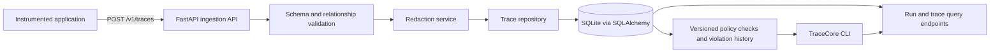

# TraceCore

TraceCore is a local-first foundation for ingesting and inspecting AI application runs and their spans. The service implements FastAPI ingestion and query endpoints, SQLite persistence, trace validation, bounded batch ingestion, and default secret redaction. The opt-in Python SDK submits real run and span telemetry. TraceCore contains no generated trace data: `live` mode shows only ingested runs.

## Problem

Agent behavior is spread across model calls, tools, and workflow steps. Without stable run and trace identifiers and explicit parent relationships, failures and latency are difficult to inspect. TraceCore records this execution structure so teams can query what ran and where errors occurred.

## Architecture



## Quick start

Requires Python 3.12 or newer.

```sh
cd tracecore
python3 -m venv .venv
. .venv/bin/activate
python -m pip install -e '.[dev]'
cp .env.example .env
alembic upgrade head
tracecore serve
```

The API listens on `http://127.0.0.1:8000`. The default database is `./tracecore.db`. For a no-key local integration, in another terminal run:

```sh
python examples/local_demo.py
curl http://127.0.0.1:8000/runs
```

The demo executes a small local workflow, measures its timestamps, and sends the resulting run and parent-child spans through HTTP ingestion. It does not seed the database. Inspect it with `GET /traces/{trace_id}` or `tracecore trace show <trace-id>`.

## Python instrumentation SDK

See [Python instrumentation](docs/instrumentation.md) for the context-manager and decorator contract.

Instrumentation is explicit. The SDK sends one completed payload to `POST /v1/traces` when the run context exits. A normal block exit without an explicit outcome is recorded as `PARTIAL`; call `finish("SUCCEEDED", ...)` only after the application knows the task completed. Exceptions produce a `FAILED` run and are re-raised after telemetry export.

```python
import tracecore

client = tracecore.TraceCoreClient(
    "http://127.0.0.1:8000",
    project_id="support-project",
    application_id="support-agent",
    environment="development",
)


@tracecore.trace_tool(capture_input=True, capture_output=True)
def lookup_account(account_id: str) -> dict[str, str]:
    return {"account_id": account_id, "state": "active"}


with client.run(
    agent_name="SupportAgent",
    agent_version="v1",
    input={"question": "Check account status"},
) as current_run:
    with tracecore.span("Planner", span_type="PLANNER") as planner:
        planner.set_attribute("plan.steps", 1)
    result = lookup_account("acct-42")
    current_run.finish("SUCCEEDED", output={"state": result["state"]})

client.close()
```

`tracecore.init(endpoint, project_id=..., application_id=...)` configures the module-level client for `with tracecore.run(...)`. The SDK also supports async functions decorated with `trace_agent`, `trace_tool`, or `trace_llm`. Decorators create spans only while a run is active; they do not patch model clients or frameworks.

Input and output capture in decorators is off by default. Set `capture_input=True` or `capture_output=True` only where content capture is appropriate. Before transmission, the SDK converts values to JSON-safe forms and applies the same credential redactor used by ingestion. Recognized credential fields and token patterns are redacted; this is not comprehensive PII detection. HTTP export failures raise `TraceExportError` on clean block exit and do not replace an application exception already in flight.

## Trace contract

`POST /v1/traces` accepts one run, a declared root span, and its spans. Run and trace identifiers are stable caller-provided strings. A trace must have exactly one root span; all parent references must resolve, identifiers must be unique, and parent links must be acyclic. Completed statuses require an explicit `completed_at`; TraceCore does not infer success from the absence of an exception. Durations are derived from timestamp pairs and remain `null` when an end timestamp is missing.

`POST /v1/traces/batch` accepts up to 100 traces and returns per-item accepted/rejected results (HTTP 207). A malformed trace does not discard valid siblings. Re-ingesting an already stored run with the same trace ID is idempotent.

## API

- `GET /health`
- `POST /auth/tokens`, `GET /auth/tokens`, `DELETE /auth/tokens/{id}` (ADMIN credential lifecycle)
- `POST /v1/traces`
- `POST /v1/traces/batch`
- `GET /runs` (filter by `environment`, `application_id`, `agent_name`, `agent_version`, `status`, `started_after`, `started_before`; paginate with `limit` and `offset`; response includes `total`)
- `GET /runs/{run_id}`
- `GET /traces/{trace_id}`
- `GET /traces/{trace_id}/spans`
- `POST /evaluations/datasets`, `GET /evaluations/datasets`, `GET /evaluations/datasets/{id}`
- `POST /evaluations/evaluators`, `GET /evaluations/evaluators`
- `POST /evaluations`, `GET /evaluations`, `GET /evaluations/{id}`
- `POST /experiments`, `GET /experiments`, `GET /experiments/{id}`
- `POST /experiments/{id}/compare`, `GET /experiments/{id}/runs`, `GET /experiment-runs/{id}`
- `POST /runs/{id}/agent-analytics`, `GET /runs/{id}/agent-analytics`
- `GET /agent-analytics?project_id=...` (optional application, agent/version, and time filters)
- `POST /policies`, `GET /policies`, `GET /policies/{id}`
- `POST /runs/{id}/policy-check`, `GET /runs/{id}/policy-checks`
- `GET /policy-evaluations/{id}`
- `GET /violations`, `GET /violations/{id}`, `PATCH /violations/{id}`, `GET /violations/{id}/history`

OpenAPI documentation is available at `/docs` while the service is running.

## Web console: Trace Explorer

The Phase 3 React/TypeScript console reads real data from the API. With TraceCore running on `127.0.0.1:8000`, start the web app in another terminal:

```sh
cd apps/web
npm ci
npm run dev
```

Open the URL printed by Vite (normally `http://127.0.0.1:5173`). The development server proxies run, trace, evaluation, experiment, agent analytics, policy, and violation requests to the local API. For a deployed web build, configure the hosting layer to proxy `/runs`, `/traces`, `/evaluations`, `/experiments`, `/experiment-runs`, `/agent-analytics`, `/policies`, `/policy-evaluations`, and `/violations` to the same TraceCore API; the web bundle does not contain a separate API URL or authentication layer.

The Runs view supports environment, application ID, agent, exact agent version, status, and start-time filters with server-backed pagination. Select a run to inspect its recorded trace timeline, span hierarchy, and span attributes, errors, timestamps, duration, and available input/output metadata. An empty API response displays **“No runs have been ingested.”** The console does not generate or seed runs.

The Evaluations view lists persisted evaluation runs and allows inspection of per-case results, stored redacted case data, evaluator versions, deterministic reasons, and unavailable checks. Create datasets, evaluator definitions, and evaluation runs through the API or `tracecore eval` CLI.

## Deterministic evaluations

Phase 4 adds immutable dataset and evaluator versions and a deterministic evaluation runner. Every evaluation maps dataset case IDs to existing ingested run IDs. TraceCore does not execute candidate agents. Results are per case and evaluator: `PASSED`, `FAILED`, or `UNAVAILABLE`; run summaries report counts and `PASS`/`FAIL`/`WARN`, with no aggregate quality score. See [Evaluation Engine](docs/evaluations.md) for supported checks, contracts, CLI usage, and limitations.

Dataset and evaluator JSON can be created through the API or CLI. Evaluation results preserve the exact dataset and evaluator versions used. Sensitive values pass through the configured redactor when datasets and evaluator configuration are stored. Costs remain unavailable unless verified cost data exists on the run. Optional `MODEL_JUDGE` evaluators support four explicitly configured assessment dimensions; provider setup, restricted-data policy, and result semantics are documented in [Model-based evaluation](docs/model-based-evaluation.md). Model assessments are stored as `ASSESSED` with separate score/confidence fields and are never counted as deterministic passes.

## Experiments

Phase 5 adds immutable experiment definition versions and persisted comparisons over explicitly mapped ingested runs. Each experiment pins one dataset version, evaluator versions, candidate configuration metadata, run mappings for every case, a baseline, and configured comparison criteria. Comparisons report deterministic evaluation breakdowns, recorded run failures, mean latency, recorded cost, and tool span counts. Missing metrics remain unavailable, and TraceCore does not choose a winner. See [Experiments](docs/experiments.md) for contracts, API and CLI examples, reproducibility requirements, and limitations.

The Experiments view can inspect definitions and saved comparisons and run comparisons over those existing runs. Create definitions through the API or CLI.

## Agent-specific analytics

Phase 6 adds deterministic summaries and loop signals over stored spans and events. Run analyses record tool outcomes, explicit retry evidence, explicit agent handoffs, and configurable repeated-tool, repeated-failure, repeated-plan, and step-count signals. Project aggregates can be filtered by application, agent/version, and time. Missing telemetry remains unavailable; repeated calls are not counted as retries. See [Agent analytics](docs/agent-analytics.md) for contracts, thresholds, API and CLI usage, privacy, and limitations.

The Agent Analytics view queries a project aggregate and can create and inspect a persisted analysis for an ingested run.

## Governance

Phase 7 adds project-scoped immutable policy versions, deterministic evaluation against stored run/span metadata, condition-level evidence, and persisted violations. Effects are `ALLOW`, `WARN`, `BLOCK`, and `REQUIRE_REVIEW`; a matching non-ALLOW policy records a violation. Missing telemetry produces `UNAVAILABLE`. `BLOCK` is retrospective in this phase and does not stop already completed runs. See [Governance](docs/governance.md) for condition semantics, evidence, waiver handling, and API/CLI examples.

The Governance view supports policy creation, stored-run checks, evidence inspection, violation state transitions, and history. Governance policy creation and checks are also available with `tracecore policy` commands.

## Production monitoring

Phase 9 adds project-scoped metrics over real runs and spans, explicit run budgets, and persisted threshold alert occurrences. Metrics identify sample counts and unavailable values; verified cost never uses the legacy estimated-cost field. Rules require explicit thresholds, windows, sample minimums, and console/database/webhook destinations. See [Production monitoring](docs/production-monitoring.md) for metric definitions, CLI and API usage, percentile behavior, delivery controls, and limitations.

The Monitoring view displays real metrics, budget status, and alert occurrence history for a supplied project ID. Alert rules and budgets are configured through the API; evaluation is on demand.

## Security and privacy

TraceCore supports SQLite for local use and PostgreSQL for deployment. Production API requests require bearer authentication, role checks, and organization/project/environment scopes. ADMIN principals can issue high-entropy, hashed, expiring/revocable database credentials; the environment token map remains a bootstrap option. Request limits are shared through the database. Retention is available as a CLI operation designed for an operator-managed system scheduler. See [production deployment](docs/deployment.md) and [security and privacy](docs/security-privacy.md) for setup, backup, audit checkpoint, and network requirements. Redaction defaults to `REDACTED`; sensitive content access and deletion are audit logged.

## Limitations

- The API remains a modular monolith. Rate limiting uses shared fixed 60-second database windows; a proxy limiter remains useful for edge shaping.
- Input/output values are bounded by the request cap but stored in relational JSON columns. Retention is explicit and manually invoked; there is no scheduler or external object store.
- Redaction is a foundation based on field names and common secret patterns, not a complete PII detector.
- The UI contains Runs and trace explorer, evaluations, experiment comparison inspection, agent analytics, governance, and production monitoring. Dataset, evaluator, evaluation, experiment, budget, and alert rule authoring use the API; the CLI supports inspection and alert evaluation.
- Deployment blocking, authenticated actor identities, human review, experiment execution of candidates, statistical comparison, scheduled alert evaluation, and replay remain unimplemented. Model-based evaluators are not included in experiment comparisons.
- The console does not provide identity-provider login, SSO, or directory lifecycle management. It accepts a bearer token in tab-scoped session storage. Use short-lived scoped database credentials where practical; the deployment bootstrap token still requires secret-manager rotation. Do not expose the service to untrusted networks without a TLS-terminating boundary.
- Retention scheduling, backup/replica expiration, legal holds, and independent append-only audit checkpoints are operator responsibilities. The database hash chain alone cannot detect a complete rewrite by a privileged database administrator.
- Run time filtering is timestamp based. Tags are displayed by trace APIs where available but are not currently a Runs filter.
- The timeline positions recorded spans by their UTC timestamp pairs; it does not infer missing end times or represent streaming token events.
- Alembic owns schema creation and upgrades; run `alembic upgrade head` before serving the API.

## PostgreSQL deployment

Set `TRACECORE_DATABASE_URL=postgresql+psycopg://...`, configure production bearer principals, then run `alembic upgrade head` before starting the API. See [deployment](docs/deployment.md) for a complete checklist. TraceCore does not create production schemas at startup.

## Development

```sh
pytest
ruff check .
mypy src
```

