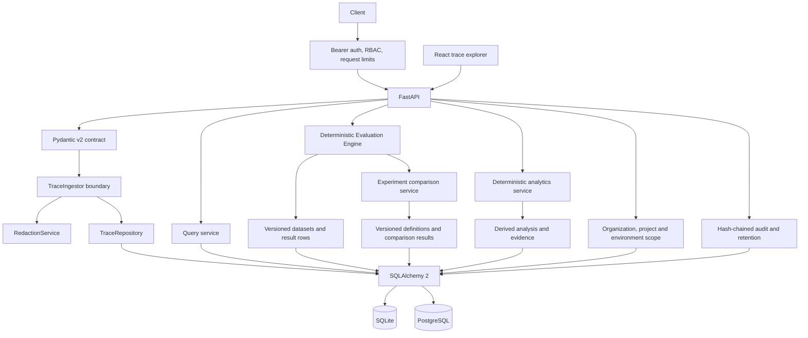

# TraceCore architecture

TraceCore is a modular monolith. The API owns validation and HTTP concerns; domain schemas describe ingestion, evaluation, and experiment contracts; repositories and services persist validated entities; and small protocols mark extension points for later modules. There are no queues, workers, analytics databases, or microservices in the current implementation.

## Architecture decisions

- SQLite is the default development store. PostgreSQL via psycopg is supported; Alembic migrations are required before serving.
- One HTTP request is one trace transaction. Batch requests commit each valid trace independently and identify rejected entries by index.
- Content remains inline in JSON columns but is bounded by `TRACECORE_MAX_PAYLOAD_BYTES`; `ContentStore` is an interface for later external storage.
- Costs are never inferred without a verified pricing registry. The current calculator boundary returns no estimate.
- In development, project and application records can be created from ingestion identifiers. Bearer ingestion additionally requires the project ID in the principal's scope and assigns organization ownership to new projects.
- Production API requests use server-side role checks, project ownership verification, and SQLAlchemy scopes for organization, project, and allowed environments. Local development mode is intentionally privileged and must not be exposed.
- Sensitive run/trace reads, credential lifecycle actions, and deletion append SHA-256 hash-chain audit events. Database-issued API credentials store token digests, support expiry/revocation, and shared rate limits use database buckets. Retention is invoked by an operator-scheduled CLI command; backups and independent audit checkpoints remain deployment responsibilities.
- Dataset and evaluator definitions are immutable numbered versions. An evaluation snapshots those versions and stores a separate result for each case/evaluator pair.
- Evaluation uses explicitly mapped ingested runs and deterministic checks only. It does not execute agents, model prompts, or custom code.
- Experiments pin dataset/evaluator versions, candidate configuration snapshots, case-to-run mappings, baselines, and explicit regression criteria. Comparison evaluates existing stored runs only; absent cost or latency remains unavailable, and no candidate winner is selected.
- Agent analytics reads stored spans/events and writes separate `agent_analyses` records with detector configuration and evidence span IDs. Source telemetry is not rewritten; missing retry/handoff instrumentation is represented as unavailable.

## Acceptance criteria

Phase 1 is acceptable when the API can ingest a real instrumented run, persist its run/trace/spans/events, preserve parent-child relationships, derive durations from timestamps, redact common secrets, and return the data from query endpoints. Invalid IDs, references, cycles, statuses, timestamps, and oversized payloads must fail with actionable errors. No live-mode fixtures or calculated scores are present.

